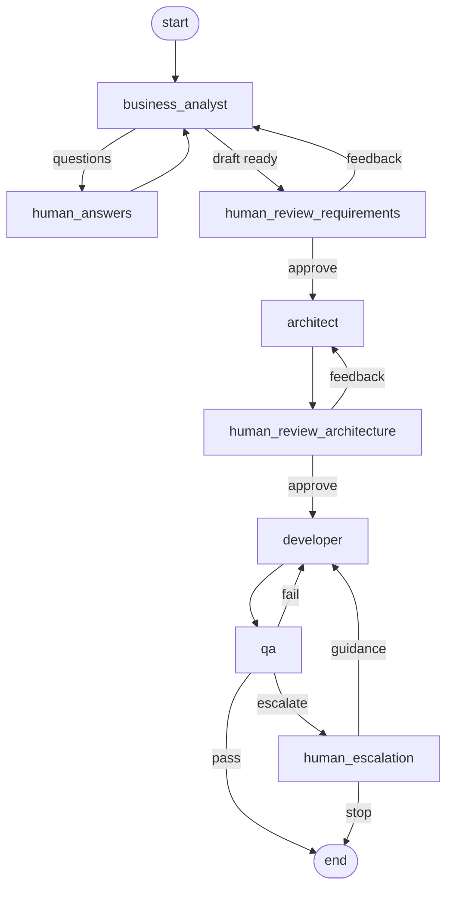

# Agentic Software Team

A learning project: a simulated four-person software team built with [LangGraph](https://langchain-ai.github.io/langgraph/) and Claude (via `langchain-anthropic`). You describe a rough idea in the terminal, and the team turns it into requirements, an architecture, working code with unit tests, and a QA report. You approve or give feedback at each stage.

| Agent | What it does |
| --- | --- |
| **Business Analyst** | The only agent that talks to you. Asks clarifying questions (at most 5 at a time) until it understands the idea, then writes requirements with user stories and testable acceptance criteria. |
| **Architect** | Turns the approved requirements into an architecture (components, interfaces, tech choices) and an ordered task list. |
| **Developer** | Writes the code files and unit tests. In later rounds it fixes the issues QA reported. |
| **QA/Refactor** | Reviews the code against every acceptance criterion. Returns pass/fail, blocking issues, and non-blocking refactor suggestions. |

## Setup

Requires Python 3.11+.

```bash
python3 -m venv .venv
source .venv/bin/activate          # Windows: .venv\Scripts\activate
pip install -r requirements.txt

cp .env.example .env               # then put your key in .env
```

`.env` needs at least `ANTHROPIC_API_KEY`. The optional settings are:

| Variable | Default | Meaning |
| --- | --- | --- |
| `SWARM_MODEL` | `claude-opus-5-5` | The Claude model every agent uses. |
| `SWARM_EFFORT` | `high` | Reasoning effort: `low`, `medium`, `high`, `xhigh`, or `max`. Lower is faster and cheaper. Set it empty for models without effort support, such as `claude-haiku-4-5`. |
| `MAX_DEV_ROUNDS` | `3` | Failed Developer/QA rounds before the run escalates to you. |

## Run it

```bash
python main.py
```

1. Describe what you want built. Answers can span several lines; finish with an empty line.
2. Answer the Business Analyst's questions.
3. Review the requirements. Type `approve`, or write feedback and the BA revises them.
4. Review the architecture the same way.
5. The Developer and QA loop on their own. If QA fails `MAX_DEV_ROUNDS` times in a row, you're asked to either give the Developer guidance (which starts a fresh set of rounds) or type `stop`.

If an agent call fails (for example, a network error), the CLI offers to retry that step from the last checkpoint.

To see the graph structure:

```bash
python main.py --diagram    # prints Mermaid; paste it into https://mermaid.live
```



## Output

Each run gets its own folder:

```
output/<run-id>/
  docs/requirements.md
  docs/architecture.md
  docs/qa_report.md      # the latest QA round
  src/                   # the generated project, including its tests
```

To try the generated code:

```bash
cd output/<run-id>/src
python -m pytest
```

Every file path the Developer returns is sanitized: absolute paths, `..`, and symlinks that lead out of `src/` are rejected, and the CLI shows what was rejected.

## Tweaking the agents

Each role's system prompt is a markdown file in `prompts/`. Edit them freely. They're re-read on every agent call, so changes apply even mid-run. The structured output fields each agent must return are defined in `swarm/schemas.py`, and their descriptions are sent to the model too.

## How it works (the LangGraph parts)

- **Shared state.** `swarm/state.py` defines a `TeamState` TypedDict. Each node gets the whole state and returns only the keys it changes. Some keys have reducers: the BA conversation and feedback lists append (`operator.add`), and `code_files` merges, so the Developer only returns the files it changed.
- **Agent nodes vs human nodes.** Agent nodes call Claude once. Human nodes (`human_*`) only call `interrupt()`, which pauses the graph and hands a payload to the CLI. The CLI resumes with `Command(resume=your_reply)`. LangGraph re-runs an interrupted node from the top on resume, which is why LLM calls never share a node with `interrupt()`: otherwise every reply would re-run (and re-pay for) the LLM call.
- **Checkpointer + thread_id.** `interrupt()` needs a checkpointer to save state while paused. This project uses the in-memory `InMemorySaver`, with the run id as the `thread_id`. A paused run therefore lives only as long as the process.
- **Routing.** Conditional edges in `swarm/graph.py` read the state (approved? QA passed? rounds left?) and pick the next node.
- **Structured output.** `swarm/llm.py` calls `ChatAnthropic(...).with_structured_output(Schema, method="json_schema")`, which uses Claude's native structured outputs. The default `function_calling` method forces a tool call, which current models such as Claude Opus 5.5 reject. Requests stream, because the SDK requires streaming for large `max_tokens`. On models that support it, server-side refusal fallbacks (`fallbacks: "default"`) are enabled, so a request declined by a safety classifier is retried on a fallback model.

## Tests

```bash
python -m pytest
```

The tests run offline and need no API key. They use a scripted fake LLM and scripted human replies to drive the full graph (feedback loops, QA failures, escalation, stop, and retry after an error). They also check path sanitization, and check `ask_agent` against a local mock of the Anthropic API.

## Limitations of v1 (ideas for later)

- Agents can't run code. QA reviews by reading, and the Developer can't execute its tests. A code-execution sandbox or tool-calling loop is the natural next step.
- State is in memory only. Swap `InMemorySaver` for `SqliteSaver` (`langgraph-checkpoint-sqlite`) to resume runs after a restart.
- The Developer sees all code in its prompt, which is fine for small projects but won't scale to big ones.
